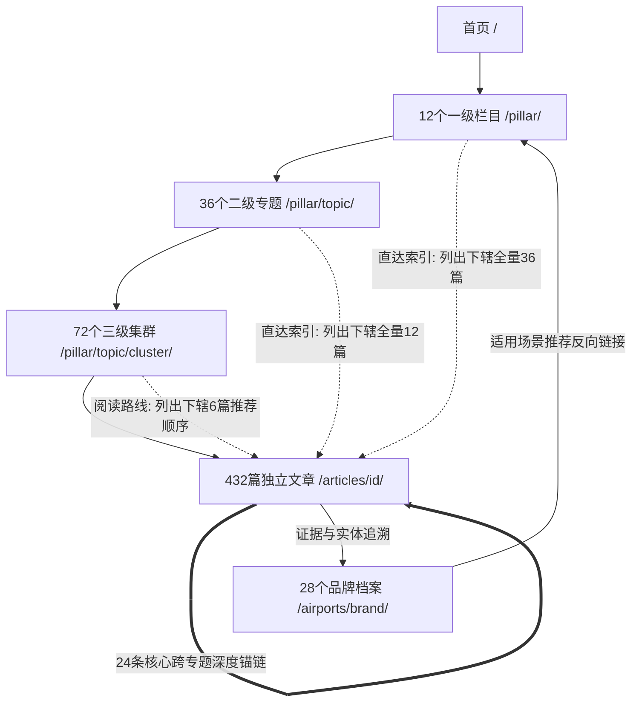

# xiaohuojianvpn.biz — 蜂巢式内链网络规划方案

本方案构建了以**需求驱动、证据支撑、逻辑闭环**为原则的蜂巢式拓扑内链结构。
全站杜绝无理由的随机插链与通用泛锚文本，确保每一条内链均有明确的上下文理由与用户价值。

---

## 一、内链拓扑结构总览

---

## 二、内链密度与考核硬指标

根据架构规范，各级页面必须达到以下内链底线标准：

| 页面层级 | 最低内链数要求 | 内链分布要求 |
|---|---|---|
| **首页** | ≥ 50 条 | 覆盖 12 个一级入口、精选二级专题、28 家主推品牌、高频排障直达 |
| **一级栏目页 (Pillar)** | ≥ 30 条 | 覆盖 3 个二级专题、6 个三级集群、全量 36 篇独立文章、关联品牌档案、相关一级栏目 |
| **二级专题页 (Topic)** | ≥ 15 条 | 向上回溯一级页、向下覆盖 2 个集群及全量 12 篇文章、跨专题关联 |
| **三级集群页 (Cluster)** | ≥ 10 条 | 向上回溯专题页、向下组织 6 篇文章的最佳阅读序列、横向关联对比 |
| **独立文章 (Article)** | ≥ 5 条 | 包含 1 条所属集群回溯、2 条同集群延伸、1-2 条跨专题深度链接、1 条品牌档案引用 |
| **品牌档案 (Brand Profile)** | ≥ 10 条 | 关联评测记录、关联推荐场景、关联套餐对比、关联优惠码、关联使用教程 |

---

## 三、层级链接与快捷通道规则

1. **面包屑完整链路**：
   - 文章页必须展示 5 级完整语义面包屑：`首页 > 一级栏目 > 二级专题 > 三级集群 > 当前文章`。
   - 保证搜索引擎理解清晰的实体归属层次，提升主题聚集度。
2. **扁平化快捷索引 (Hub Direct Index)**：
   - **一级栏目页**：在正文专门板块中，按主题直接列出辖下的 **全量 36 篇** 已发布文章；
   - **二级专题页**：按问题直接列出辖下的 **全量 12 篇** 文章；
   - **三级集群页**：以“推荐阅读路线”呈现辖下的 **6 篇** 文章。
   - **用户旅程优化**：重要文章实现 `首页 → 一级栏目 → 文章` 的 2 次点击直达，无需逐层强迫点击 4 次。

---

## 四、24 条核心跨专题/跨栏目深度链接矩阵

本站预设的 24 条高价值跨专题锚链覆盖了“选型 → 计算 → 证据 → 使用 → 排障 → 原理”的主线流转，使用具象描述型锚文本，坚决杜绝“点击这里”或千篇一律的“机场推荐”：

| 序号 | 来源文章与 URL | 目标文章与 URL | 规定锚文本 | 业务与逻辑理由 |
|---|---|---|---|---|
| 1 | [5 元档机场有哪些？实际月付金额与流量说明](file:////articles/art-chp-001/) | [月付、季付、年付的对比方法](file:////articles/art-pln-001/) | **月付、季付和年付周期实付比较** | 统一实际付款周期，避免将折算年费误认为真实月付门槛 |
| 2 | [按量付费机场怎样计算每GB成本？加入倍率与附加费用的比较方法](file:////articles/art-pln-008/) | [流量倍率的应用与影响](file:////articles/art-pln-014/) | **节点流量倍率对实际消耗的影响** | 解释每GB成本公式中的关键倍率放大参数 |
| 3 | [稳定机场怎么选？晚高峰、连续使用与故障恢复证据对比](file:////articles/art-rec-025/) | [机场可用性如何测量：成功标准与观察窗口](file:////articles/art-rev-019/) | **晚高峰可用性与断连观测方法** | 查看推荐榜单背后具体的量化测试依据与时间窗口 |
| 4 | [AI API 网络要求](file:////articles/art-ai-019/) | [特定应用无法连接](file:////articles/art-trb-032/) | **AI 客户端及 API 接口连接异常排查** | 区分网络超时与应用层鉴权限流，直接引导进入排障定位 |
| 5 | [电视端使用机场的方式](file:////articles/art-stm-031/) | [路由器接入说明](file:////articles/art-clt-031/) | **路由器透明代理使用前准备** | 在大屏无法原生安装客户端时，平滑衔接网关级网络方案 |
| 6 | [免费资源的流量与时长额度说明](file:////articles/art-fre-009/) | [小流量月付机场有哪些？50GB 以下的套餐对比](file:////articles/art-chp-007/) | **50GB 以下小流量低门槛付费选型** | 在免费流量用尽或额度不足时，提供低试错成本的付费替代 |
| 7 | [AI 数据的可见边界](file:////articles/art-ai-034/) | [TLS 加密基础](file:////articles/art-wik-019/) | **TLS 端到端加密保护边界与明文泄露风险** | 从密码学原理理解节点服务商对应用层请求内容的数据可见性 |
| 8 | [品牌域名变更记录](file:////articles/art-apt-004/) | [订阅地址访问失败完整说明](file:////articles/art-trb-006/) | **机场官网域名变更导致的订阅更新失败排查** | 将服务商官网更换域名的公开事件，与本地客户端订阅更新 404 挂钩 |
| 9 | [第一次买机场怎么选？从设备、用途到套餐的完整决策流程](file:////articles/art-rec-001/) | [Windows 客户端下载来源](file:////articles/art-clt-003/) | **通用客户端官方安全下载渠道** | 为新手选型后提供安全无劫持的客户端安装前置支持 |
| 10 | [不限时机场套餐是什么意思？流量有效期与账户有效期需要分开看](file:////articles/art-pln-007/) | [偶尔使用的机场怎么选？按量付费与月付对比](file:////articles/art-chp-013/) | **间歇低频使用者的套餐成本计算** | 辨析不限时概念与实际按量成本的盈亏平衡点 |
| 11 | [ChatGPT 用什么机场？网页访问与任务核验](file:////articles/art-ai-001/) | [原生 IP 与广播 IP](file:////articles/art-wik-034/) | **原生 IP 与数据中心广播 IP 对风控的影响** | 解释为什么 OpenAI 拒绝访问往往与出口 IP 属性直接相关 |
| 12 | [Netflix 用什么机场？地区与账号条件](file:////articles/art-stm-001/) | [视频播放任务测试方法](file:////articles/art-rev-031/) | **流媒体非自制剧播放与解锁测试标准** | 将平台选型引导至可重复核验的实测证据链 |
| 13 | [TUN 模式启动失败处理](file:////articles/art-trb-014/) | [TUN 模式说明](file:////articles/art-clt-023/) | **TUN 虚拟网卡工作机制与配置规则** | 故障发生后提供正常的工作机制原理以协助定位核心冲突 |
| 14 | [IEPL 专线说明](file:////articles/art-wik-007/) | [线路标签与实际观测的区别](file:////articles/art-wik-011/) | **专线宣传标签与晚高峰实测表现对照** | 打破专线绝对神话，建立基于网络观测的客观认知 |
| 15 | [优惠后实际付款金额](file:////articles/art-cpn-017/) | [年付实际总支出计算：含首购与续费](file:////articles/art-chp-032/) | **年付折扣叠加优惠码后的跨周期总支出** | 跨专题核算折后首付与后续原价续费的综合持有成本 |
| 16 | [主用加备用机场怎么搭配？故障独立性、成本与管理难度比较](file:////articles/art-rec-009/) | [主力机场与备用机场的预算怎么分配？](file:////articles/art-chp-019/) | **双服务冗余方案的预算分配矩阵** | 从架构容灾设计顺延至实际的资金支出配比 |
| 17 | [只有手机的新手适合哪类机场？自有客户端与通用客户端方案比较](file:////articles/art-rec-003/) | [手机与平板客户端完整指南](file:////articles/art-clt-012/) | **iOS与Android移动端代理客户端配置详解** | 指导移动端单一设备用户如何正确配置通用协议软件 |
| 18 | [全部节点超时排查](file:////articles/art-trb-019/) | [系统代理残留清理](file:////articles/art-trb-016/) | **系统底层代理残留与环路拦截排查** | 针对全节点红字超时的高发原因提供直接修复路径 |
| 19 | [4K 播放的网络要求](file:////articles/art-stm-014/) | [峰值速度与持续速度的区别](file:////articles/art-rev-016/) | **持续吞吐与瞬间峰值速度的统计差异** | 解释为什么测速软件瞬间飙高但 4K 播放依然缓冲卡顿 |
| 20 | [Cursor 与 GitHub Copilot 网络配置](file:////articles/art-ai-014/) | [开发环境代理配置](file:////articles/art-clt-032/) | **终端环境变量与 IDE 代理链路配置** | 为编程工具提供从 IDE 层到操作系统底层的完整连通指南 |
| 21 | [机场的退款条款应该怎么看？申请条件、例外情况与证据留存](file:////articles/art-rec-028/) | [品牌服务条款核查](file:////articles/art-apt-015/) | **服务商公开发布的服务协议 (ToS) 审查方法** | 从购买权衡深入到品牌服务合同的具体约定 |
| 22 | [TCP与UDP在代理连接中有什么区别？可靠传输、时延与应用需求解析](file:////articles/art-wik-013/) | [网络丢包时TCP连接会怎样变化？理解重传、拥塞控制与吞吐下降](file:////articles/art-wik-015/) | **TCP 拥塞窗口收缩与重传引起的吞吐衰减** | 深入协议传输层内部剖析为什么丢包率轻微上升会导致严重降速 |
| 23 | [年付套餐的风险评估](file:////articles/art-chp-035/) | [品牌退出记录](file:////articles/art-apt-033/) | **历史机场突发失联与停运档案库** | 用行业真实发生的退出案例作为年付预付风险的佐证 |
| 24 | [公共场所 Wi-Fi 使用机场应该注意什么？安全与连接检查](file:////articles/art-rec-015/) | [DNS 解析流程](file:////articles/art-wik-031/) | **公共网络下的 DNS 劫持与安全防护方案** | 从外出场景安全延伸至底层 DNS 安全解析机制 |

---

## 五、品牌档案双向网状连接 (Brand Entity Web)

全站 28 个品牌档案页面（`/airports/{brand-slug}/`）作为统一实体资料库，构建如下闭环：

1. **文章引用品牌**：
   - 当文章提及具体品牌（如“闪电鼠”、“大佬云”）时，通过 `<BrandBlock>` 或语义锚链链接至其档案页 `/airports/{brand-slug}/`。
   - 标注 `dataStatus: "vendor" | "measured" | "unverified"`，声称内容带“品牌资料显示”。
2. **档案反哺文章**：
   - 品牌档案页展示该品牌在“机场推荐”、“便宜机场”、“AI 机场”、“流媒体机场”中的对应解读；
   - 档案页展示该品牌的最新实测证据（直链 `/reviews/` 下辖相关测速记录）；
   - 档案页展示有效优惠码（直链 `/coupons/` 相关条目）。
3. **商业合规标记**：
   - 出站注册链接统一带 `target="_blank" rel="nofollow sponsored noopener"`；
   - 显著标明商业合作披露文字：“含推广链接，通过链接注册可能为本站带来佣金，不影响用户支付价格”；
   - 严格规范外链重定向与安全属性。
